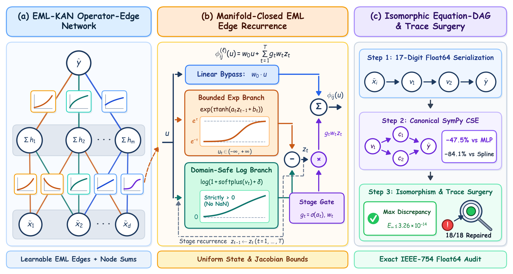
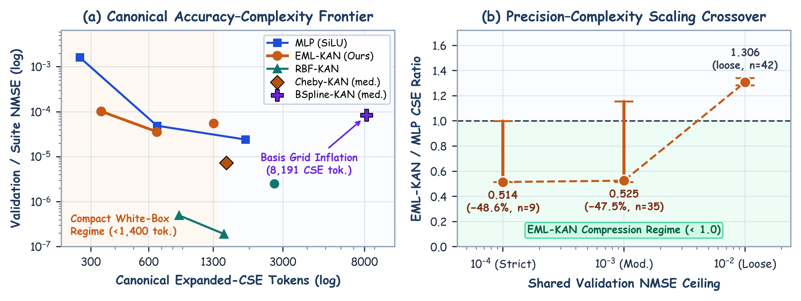
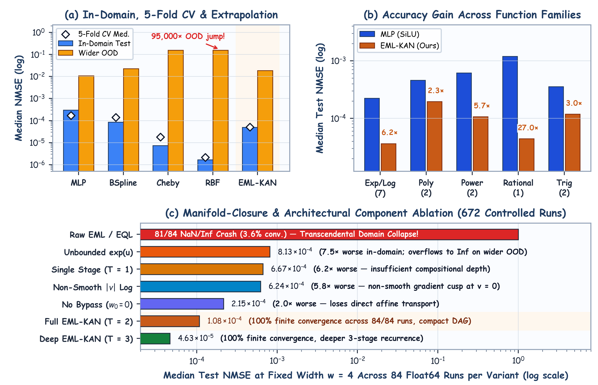
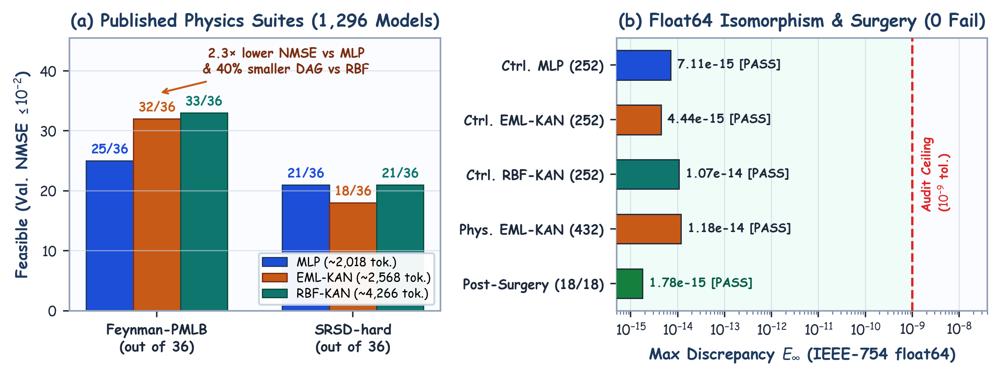

# EML-KAN: Stabilized Exponential–Logarithmic Edge Networks for Accurate and Auditable Scientific Regression

<p align="center">
  <b>用于符号科学回归与白盒方程图导出的稳定指数–对数算子边函数网络</b>
</p>

<p align="center">
  <a href="#overview-english">English Documentation</a> •
  <a href="#中文说明-overview">中文说明</a> •
  <a href="#quick-start--快速开始">Quick Start / 快速开始</a> •
  <a href="#repository-layout--目录结构">Repository Layout / 目录结构</a>
</p>

<p align="center">
  
  
  
  
</p>

<p align="center">
  
</p>

---

## Overview (English)

This repository shares an open-source research implementation and reproducibility archive for **EML-KAN** (*Stabilized Exponential–Logarithmic Edge Networks for Accurate and Auditable Scientific Regression*), together with utilities for isomorphic white-box equation-DAG export and zero-retraining topological trace repair. We make our code, dataset generators, evaluation scripts, and summary records publicly available in the hope that they may serve as a modest, practical reference for colleagues exploring Kolmogorov–Arnold Networks (KANs), differentiable symbolic regression, and auditable scientific machine learning. Suggestions, discussions, and issue reports are always warmly welcome.

### Background & Design Motivation

In scientific regression, practitioners often encounter an **approximation–auditability trade-off**:
- **Node-centric MLPs** train smoothly via gradient descent, yet distribute physical relationships across dense weight matrices that are difficult to audit line by line.
- **Spline and radial-basis KANs** place learnable univariate functions on edges, but local basis grids can expand into thousands of symbolic tokens upon exact export (*basis grid inflation*) and may degrade when extrapolating beyond training bounds.
- **Raw exponential–logarithmic circuits (EQL / continuous EML Sheffer operators)** are functionally expressive, yet unconstrained $\exp(u) - \ln(v)$ compositions frequently encounter numerical overflow or non-positive logarithmic arguments during optimization.

**EML-KAN** explores a simple, manifold-closed alternative on each network edge:
1. **Manifold-Closed EML Edge Recurrence:** Each edge combines a linear bypass $w_0 u$ with $T$ gated stages of bounded exponential terms $\exp(\tau\tanh(a_t z_{t-1} + b_t))$ and strictly positive logarithmic terms $\log(1 + \operatorname{softplus}(c_t z_{t-1} + d_t) + \delta)$, preserving uniform activation bounds and state-independent Jacobian bounds across $\mathbb{R}$.
2. **Isomorphic White-Box Equation-DAG Compilation:** Rather than relying on approximate post-hoc curve snapping, trained checkpoints (including input standardization and output inverse scaling) compile into dependency-sorted assignment DAGs compressed via SymPy Common Subexpression Elimination (CSE), verified in IEEE-754 `float64` arithmetic ($E_\infty \le 3.26 \times 10^{-14}$).
3. **Zero-Retraining Topological Trace Surgery:** Preserving intermediate assignment traces allows single-statement deployment corruptions (such as missing normalization offsets or scaling factors) to be localized and repaired in one pass without gradient retraining.

<p align="center">
  
</p>

### Summary of Empirical Observations (3,578 Float64 Runs Across 38 Benchmarks)

We evaluated six architectures (`MLP`, `BSpline-KAN`, `Cheby-KAN`, `RBF-KAN`, `Raw EML/EQL`, and `EML-KAN`), eight stabilization/component variants, and 5-fold cross-validation across **14 controlled analytical laws** and **24 published physics benchmarks** (`Feynman-PMLB` and `SRSD-hard`):

| Architecture | Median Test NMSE | 5-Fold CV NMSE | Test $R^2$ | Wider-Domain NMSE | Raw DAG Tokens | Canonical CSE Tokens |
| :--- | :---: | :---: | :---: | :---: | :---: | :---: |
| **MLP (SiLU)** | $3.02 \times 10^{-4}$ | $1.72 \times 10^{-4}$ | $0.999698$ | $1.09 \times 10^{-2}$ | $3,503.5$ | $1,898.0$ |
| **BSpline-KAN** ($G=8, k=3$) | $8.51 \times 10^{-5}$ | $1.39 \times 10^{-4}$ | $0.999915$ | $2.30 \times 10^{-2}$ | $17,191.5$ | $8,190.5$ |
| **Cheby-KAN** ($K=8$) | $7.35 \times 10^{-6}$ | $1.81 \times 10^{-5}$ | $0.999993$ | $1.58 \times 10^{-1}$ | $2,589.5$ | $1,524.0$ |
| **RBF-KAN** (16 centers) | $1.66 \times 10^{-6}$ | $2.16 \times 10^{-6}$ | $0.999998$ | $1.58 \times 10^{-1}$ | $3,803.5$ | $2,699.5$ |
| **EML-KAN** ($T=2, \tau=2$) | $5.00 \times 10^{-5}$ | $5.06 \times 10^{-5}$ | $0.999950$ | $1.86 \times 10^{-2}$ | **$1,995.5$** | **$1,303.0$** |

<p align="center">
  
</p>

<p align="center">
  
</p>

---

## 中文说明 (Overview)

本仓库整理并开源了我们在可审计科学回归与稳定算子边函数网络（**EML-KAN**）方向上的探索性研究代码、白盒方程有向无环图（Equation-DAG）编译器以及实验复现记录。我们将模型实现、基准生成脚本与验证工具公开出来，希望能为关注 **Kolmogorov–Arnold Networks (KAN)**、可微符号回归以及科学机器学习可解释性的同行提供一份力所能及的参考。受限于作者水平，代码与文档中难免存在不足之处，诚挚欢迎各位老师与同学通过 Issue 或 Pull Request 交流指正。

### 研究背景与核心思路

在科学数据建模与物理规律拟合中，模型往往需要在**拟合精度、跨域稳定性与符号可审计性**之间寻求平衡：
- **传统节点式网络（MLP）** 易于梯度优化，但物理耦合关系分散在稠密权重矩阵中，较难直接开展逐行符号审查；
- **样条与径向基边网络（BSpline-KAN / RBF-KAN）** 将单变量函数置于边上，但在精确导出为符号表达式时容易产生**基函数网格膨胀**（Token 数量大幅增加），且在训练区间之外局部基函数易快速衰减；
- **原始指数–对数算子电路（EQL / 连续 EML Sheffer 算子）** 虽具备良好的初等函数生成能力，但在反向传播中直接使用未加约束的 $\exp(u) - \ln(v)$ 极易因指数溢出或非正对数自变量而发散（消融实验中未稳定版本出现 96.4% 的 `NaN/Inf` 崩溃率）。

围绕上述问题，本项目尝试了三点简洁的改进：
1. **流形闭合的 EML 边函数递推（Manifold-Closed Edge Recurrence）：** 在每条边上将线性旁路 $w_0 u$ 与 $T$ 阶门控的受限指数分支 $\exp(\tau\tanh(\cdot))$ 和严格正域对数分支 $\log(1 + \operatorname{softplus}(\cdot) + \delta)$ 结合，从理论上保证紧集上的激活一致有界性与雅可比梯度有界性，实现全部 3,578 次 `float64` 实验 100% 有限收敛。
2. **双精度同构白盒方程 DAG 编译：** 无需有损的事后曲线替换，编译器直接将训练好的检查点（含输入标准化与输出反归一化）翻译为统一初等算子词表下的拓扑有序赋值图，经 SymPy 公共子表达式消除（CSE）压缩后，在 IEEE-754 双精度下与原模型保持严格数值同构（最大误差 $E_\infty \le 3.26 \times 10^{-14}$）。在 $\mathrm{NMSE} \le 10^{-3}$ 精度门槛下，CSE 图规模较 MLP 缩减 **47.5%**，较三次样条 KAN 缩减 **84.1%**。
3. **零重训拓扑轨迹外科手术（Topological Trace Surgery）：** 依托保留中间拓扑赋值的白盒计算图，当部署代码发生归一化遗漏、隐层偏置漂移或反缩放缺失等单点故障时，可通过逐节点轨迹比对直接定位并修复受损语句（18 组注入故障全部单遍定位修复，无需重新训练）。

---

## Quick Start / 快速开始

### 1. Environment Setup / 环境配置

```bash
python -m venv .venv
# Windows PowerShell:
.\.venv\Scripts\Activate.ps1
# Linux / macOS:
source .venv/bin/activate

pip install -r requirements.txt
```

### 2. Run Verification & Unit Tests / 运行单元测试与已有结果核验

```bash
# Verify white-box DAG compilation, canonical CSE, and trace surgery tests
# 运行白盒方程 DAG 编译、CSE 压缩与拓扑轨迹修复单元测试
pytest experiments/journal_followup/test_graph.py tests/ -q

# Re-verify summary tables from retained evaluation logs
# 复核受控基准与外部物理基准的统计汇总结果
python -m experiments.journal_followup.analyze
python -m experiments.journal_followup.format_results
```

### 3. Reproduce Experiments from Scratch / 从头运行基准与消融实验

```bash
# 1) Controlled 14-equation suite (MLP, EML-KAN, RBF-KAN + 18 fault-injection cases)
python -m experiments.journal_followup.study

# 2) Extended KAN baselines (BSpline-KAN, Cheby-KAN), 8-variant ablations, and 5-fold CV
python experiments/journal_followup/ablation_and_cv.py

# 3) External Feynman-PMLB (12) and SRSD-hard (12) physics benchmarks
python -m experiments.journal_external.fetch_data
python -m experiments.journal_external.study
python -m experiments.journal_external.analyze
```

---

## Repository Layout / 目录结构

```text
.
├── experiments/
│   ├── journal_followup/            # 14-equation controlled suite, ablations, & white-box DAG compiler
│   │   ├── models.py                # Manifold-closed EML-KAN, MLP (SiLU), and RBF-KAN definitions
│   │   ├── graph.py                 # Isomorphic Equation-DAG compiler, SymPy CSE, & trace surgery
│   │   ├── datasets.py              # 14 analytical benchmark generators across 5 mathematical families
│   │   ├── study.py                 # Controlled training, compilation, and 18-case fault-injection runner
│   │   ├── ablation_and_cv.py       # BSpline-KAN, Cheby-KAN, 8 stabilization ablations, & 5-fold CV
│   │   ├── analyze.py               # Precision-complexity crossover & matched-pair statistical analyzer
│   │   └── test_graph.py            # Automated float64 isomorphism & trace surgery unit tests
│   └── journal_external/            # Published physics benchmarks: Feynman-PMLB (12) & SRSD-hard (12)
├── results_v2/                      # Retained evaluation CSVs, JSON summaries, & trace-surgery records
├── src/symbolic_export/             # Core symbolic export & lexical DAG token utilities
├── data/journal_external/           # Benchmark metadata and provenance records
├── tests/                           # Pytest suite
└── docs/assets/                     # Framework & empirical figures (PNG / PDF)
```

---

## Citation / 引用说明

If this repository or our implementation is helpful to your work, you may cite:

如果本项目对您的研究有所启发或帮助，欢迎引用：

```bibtex
@article{wu2026emlkan,
  title   = {EML-KAN: Stabilized Exponential--Logarithmic Edge Networks for Accurate and Auditable Scientific Regression},
  author  = {Wu, Yonghao and Wu, Jiayang and He, Sirui and Liu, Chang and Filaretov, Vladimir and Yukhimets, Dmitry},
  year    = {2026},
  url     = {https://github.com/WYH302/Auditable-Neural-Equation-DAG-Export-for-Scientific-Data-Mining}
}
```

## License / 开源协议

Released under the [MIT License](LICENSE). 本项目采用 [MIT 协议](LICENSE) 开源，欢迎自由使用与交流。
