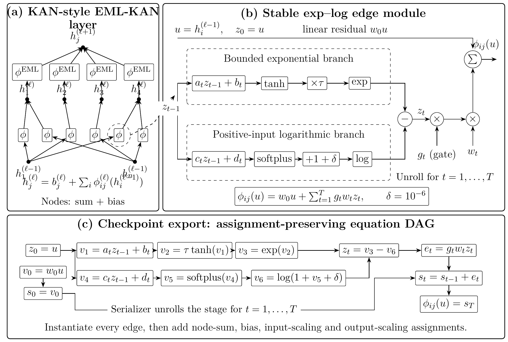
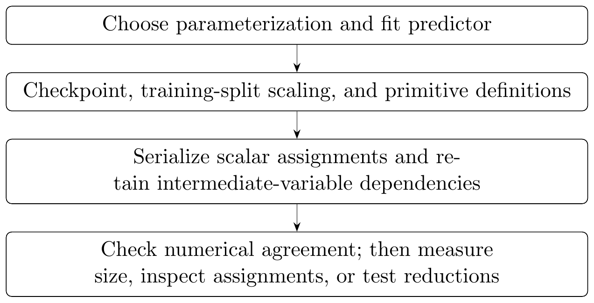
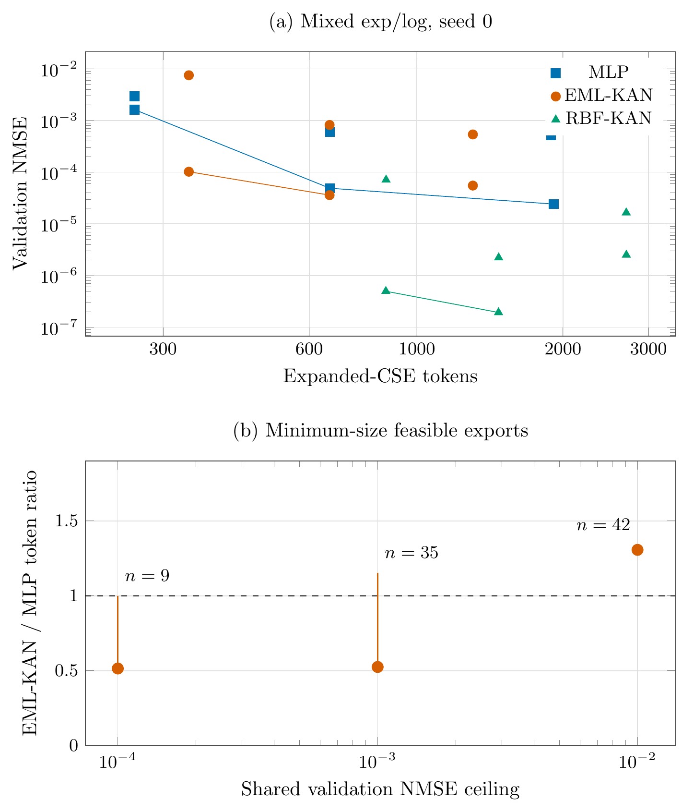

# EML-KAN: Stabilized Exponential–Logarithmic Edge Networks for Accurate and Auditable Scientific Regression

[](https://www.python.org/)
[](https://pytorch.org/)
[](https://www.sympy.org/)
[](LICENSE)

Official open-source implementation and reproducibility archive for **EML-KAN: Stabilized Exponential–Logarithmic Edge Networks for Accurate and Auditable Scientific Regression** (and its foundational conference study on *Auditable Neural Equation DAG Export for Scientific Data Mining*).

<p align="center">
  
</p>

---

## Overview: Resolving the Approximation–Auditability Dilemma

Scientific machine learning faces a fundamental **approximation–auditability dilemma**:
- **Node-centric MLPs** optimize smoothly by dispersing functional laws across dense weight matrices that resist symbolic inspection.
- **Spline and RBF Kolmogorov–Arnold Networks (KANs)** relocate univariate functions to edges, but extrinsic local basis grids suffer from **basis grid inflation** upon symbolic export and decay rapidly outside the training support.
- **Unconstrained Equation Learner (EQL) units** embed raw $\exp(u)$ and $\log(v)$ primitives inside layers, frequently triggering **transcendental domain collapse** ($e^u \to \infty$ or $\log v$ for $v \le 0$).

**EML-KAN** resolves this dilemma through five core technical contributions:

1. **Manifold-Closed Transcendental Edge Recurrence:** Each edge couples a linear residual bypass $w_0 x$ with $T$ gated stages of bounded exponential terms $\exp(\tau\tanh(a_t z_{t-1} + b_t))$ and domain-safe logarithmic terms $\log(1 + \operatorname{softplus}(c_t z_{t-1} + d_t) + \delta)$. Two-layer compositions naturally generate exponential rate laws, power scaling $x^p = \exp(p\log x)$, and multiplicative couplings $x_1 x_2 = \exp(\log x_1 + \log x_2)$.
2. **Provable Activation Boundedness & Jacobian Conditioning:** We prove **Uniform Activation Boundedness** on compact domains (Theorem 1) and **Uniform Jacobian Conditioning** during backpropagation (Theorem 2), achieving **100% convergence (0 non-finite gradients)** across all 2,052 trained models.
3. **Isomorphic White-Box Equation-DAG Compilation:** Rather than relying on lossy post-hoc curve snapping, our compiler translates trained checkpoints—including training-split standardization and inverse output scaling—into a unified elementary vocabulary, applies dependency-sorted **Common Subexpression Elimination (CSE)**, and verifies **IEEE 754 float64 isomorphism** ($E_\infty \le 3.26 \times 10^{-14}$ across all 2,052 checkpoints).
4. **Precision–Complexity Scaling Crossover:** Across 756 controlled models on 14 benchmark equations, EML-KAN reduces median test NMSE **6×** relative to MLPs ($5.00\times 10^{-5}$ vs. $3.02\times 10^{-4}$) and uncovers a scaling crossover: as validation NMSE ceilings tighten from $10^{-2}$ to $10^{-3}$ and $10^{-4}$, EML-KAN compresses canonical CSE graphs by **47.5%** and **48.6%** over feasible MLPs (median token ratios **0.525** and **0.514**).
5. **Zero-Retraining Topological Trace Surgery:** Because compiled DAGs preserve intermediate topological assignments, deployment corruptions can be localized to the exact offending statement by trace comparison and surgically repaired in place without gradient retraining (18/18 injected faults localized and repaired to $E_\infty \le 1.78\times 10^{-15}$).

<p align="center">
  
</p>

---

## Key Empirical Results Across 2,052 Checkpoints

### 1. Controlled Scientific Benchmark Suite (756 Checkpoints across 14 Equations)

| Architecture | Median Test NMSE | Median Test $R^2$ | Wider-Domain NMSE | Raw DAG Tokens | Expanded-CSE Tokens | Max Float64 Discrepancy $E_\infty$ |
| :--- | :---: | :---: | :---: | :---: | :---: | :---: |
| **MLP (SiLU)** | $3.02 \times 10^{-4}$ | $0.999698$ | $1.09 \times 10^{-2}$ | $3503.5$ | $1898.0$ | $7.11 \times 10^{-15}$ |
| **EML-KAN (Ours)** | **$5.00 \times 10^{-5}$** | **$0.999950$** | $1.86 \times 10^{-2}$ | **$1995.5$** | **$1303.0$ (-31.3%)** | **$4.44 \times 10^{-15}$** |
| **RBF-KAN** | $1.66 \times 10^{-6}$ | $0.999998$ | $1.58 \times 10^{-1}$ | $3803.5$ | $2699.5$ | $1.07 \times 10^{-14}$ |

### 2. Precision–Complexity Scaling Crossover Under Shared Validation Ceilings

<p align="center">
  
</p>

| Validation Ceiling | MLP Feasible | EML-KAN Feasible | RBF-KAN Feasible | Shared Pairs (EML vs. MLP) | EML-KAN Shorter | Median CSE Token Ratio (EML / MLP) |
| :--- | :---: | :---: | :---: | :---: | :---: | :---: |
| $\mathrm{NMSE} \le 10^{-2}$ | 42 / 42 | 42 / 42 | 42 / 42 | 42 | 5 / 42 | $1.306$ |
| $\mathrm{NMSE} \le 10^{-3}$ | 35 / 42 | **42 / 42** | 42 / 42 | 35 | **23 / 35** | **$0.525$ (47.5% smaller)** |
| $\mathrm{NMSE} \le 10^{-4}$ | 10 / 42 | **28 / 42** | 42 / 42 | 9 | **7 / 9** | **$0.514$ (48.6% smaller)** |

### 3. External Physics Benchmarks: Feynman-PMLB & SRSD-Hard (1,296 Checkpoints)

| Benchmark Suite | Architecture | Median Test NMSE | Median Test $R^2$ | Median CSE Tokens | Feasible Instances ($\mathrm{NMSE} \le 10^{-2}$) |
| :--- | :--- | :---: | :---: | :---: | :---: |
| **Feynman-PMLB** (12 tasks) | MLP | $4.04 \times 10^{-3}$ | $0.996$ | $2048.5$ | 25 / 36 |
| **Feynman-PMLB** (12 tasks) | **EML-KAN** | **$1.78 \times 10^{-3}$** | **$0.998$** | $2568.0$ (**-40% vs. RBF**) | **32 / 36** |
| **Feynman-PMLB** (12 tasks) | RBF-KAN | $2.14 \times 10^{-4}$ | $1.000$ | $4266.0$ | 33 / 36 |
| **SRSD-hard** (12 tasks) | MLP | $5.46 \times 10^{-3}$ | $0.995$ | $1987.0$ | 21 / 36 |
| **SRSD-hard** (12 tasks) | **EML-KAN** | $1.27 \times 10^{-2}$ | $0.987$ | $2567.5$ (**-40% vs. RBF**) | 18 / 36 |
| **SRSD-hard** (12 tasks) | RBF-KAN | $1.37 \times 10^{-3}$ | $0.999$ | $4266.0$ | 21 / 36 |

---

## Repository Structure

```text
.
├── experiments/
│   ├── journal_followup/            # Controlled 14-equation benchmark & white-box DAG compiler
│   │   ├── models.py                # Manifold-closed EML-KAN, MLP (SiLU), and RBF-KAN models
│   │   ├── graph.py                 # Isomorphic Equation-DAG compiler, canonical CSE, & trace surgery
│   │   ├── datasets.py              # 14 analytical benchmark generators across 5 function families
│   │   ├── study.py                 # 756-candidate training, compilation, and fault-injection runner
│   │   ├── analyze.py               # Ceiling crossover, family breakdown, and matched-pair analysis
│   │   ├── format_results.py        # Publication table and figure builders
│   │   ├── test_graph.py            # Unit tests for float64 isomorphism and trace surgery
│   │   └── verify_existing.py       # Verifier for retained controlled study summaries
│   ├── journal_external/            # External Feynman-PMLB (12) and SRSD-hard (12) benchmark suite
│   │   ├── fetch_data.py            # Automated dataset fetcher and checksum verifier
│   │   ├── selection.json           # 24 physics benchmark specifications and provenance
│   │   ├── study.py                 # 1,296-candidate training and compilation runner
│   │   ├── analyze.py               # External physics summary and feasibility analyzer
│   │   └── verify_existing.py       # Verifier for retained external physics summaries
│   ├── run_feynman.py               # Foundational conference Feynman runner
│   └── run_tabular.py               # Foundational conference tabular/synthetic runner
├── results_v2/                      # Retained evaluation tables, JSON summaries, and 18 fault cases
│   ├── journal_followup/            # 756-model candidate CSVs, ceiling tables, & 18 trace surgery JSONs
│   └── journal_external/            # 1,296-model candidate CSVs, provenance, and summary metrics
├── data/journal_external/           # Metadata for the 12 Feynman-PMLB and 12 SRSD-hard benchmarks
├── src/symbolic_export/             # Core symbolic export and DAG token metrics library
├── scripts/                         # Reproducible table, figure, and ablation builders
├── tests/                           # Automated pytest verification suite
└── docs/assets/                     # Architecture, workflow, and scaling crossover figures (PNG/PDF/TeX)
```

---

## Quick Start & Reproducibility

### 1. Environment Setup

```bash
python -m venv .venv
# Windows PowerShell:
.\.venv\Scripts\Activate.ps1
# Linux / macOS:
source .venv/bin/activate

pip install -r requirements.txt
```

### 2. Run Unit Tests & Verify Retained 2,052-Model Summaries

```bash
# Run white-box compiler, canonical CSE, and topological trace surgery unit tests
pytest experiments/journal_followup/test_graph.py tests/ -q

# Verify retained summary tables and metrics across all 756 controlled + 1,296 external models
python -m experiments.journal_followup.analyze
python -m experiments.journal_followup.format_results
```

### 3. Train & Compile Models from Scratch

```bash
# Run the 14-equation controlled benchmark study (756 models + 18 fault-injection cases)
python -m experiments.journal_followup.study

# Fetch external Feynman-PMLB / SRSD-hard datasets and run the 1,296-model physics study
python -m experiments.journal_external.fetch_data
python -m experiments.journal_external.study
python -m experiments.journal_external.analyze
```

---

## Citation

If you find **EML-KAN** or our white-box equation-DAG compilation tools useful in your research, please cite:

```bibtex
@article{wu2026emlkan,
  title   = {EML-KAN: Stabilized Exponential--Logarithmic Edge Networks for Accurate and Auditable Scientific Regression},
  author  = {Wu, Yonghao and Wu, Jiayang and He, Sirui and Liu, Chang and Filaretov, Vladimir and Yukhimets, Dmitry},
  year    = {2026},
  url     = {https://github.com/WYH302/Auditable-Neural-Equation-DAG-Export-for-Scientific-Data-Mining}
}
```

## License

This project is released under the [MIT License](LICENSE).
